 

# 📱 Awesome Native Mobile App QA & Automation 🚀

> **A definitive, curated directory of leading Native Mobile App QA, Test Automation platforms, and Device Cloud frameworks.** Covering enterprise SaaS real-device clouds, AI-driven visual regression suites, and battle-tested open-source test runners for native **iOS (XCUITest)**, **Android (UIAutomator/Espresso)**, **React Native**, and **Flutter** applications.

✨ *Find the ideal test framework or enterprise device cloud to eliminate regressions, accelerate CI/CD build pipelines, and scale cross-device testing without device farm maintenance headache.* ✨

🌟 **Star this repository if it powers your QA automation strategy!** 🌟

---

## 📑 Table of Contents

- [🌐 Sector Overview & Market Dynamics](#-sector-overview--market-dynamics)
- [☁️ Enterprise SaaS Device Clouds & QA Platforms](#️-enterprise-saas-device-clouds--qa-platforms)
- [🛠️ Open-Source Mobile Test Automation Frameworks](#️-open-source-mobile-test-automation-frameworks)
- [⚖️ Feature & Architecture Comparison](#️-feature--architecture-comparison)
- [💡 Key Selection Criteria & Engineering Trade-offs](#-key-selection-criteria--engineering-trade-offs)
- [🤝 Contributing & Community Standards](#-contributing--community-standards)
- [📄 License](#-license)

---

## 🌐 Sector Overview & Market Dynamics

> 📈 **Market Sizing & Forecast:** The global mobile application testing market is valued at approximately **$7.7 Billion to $11.4 Billion** and is projected to expand to over **$25 Billion to $35 Billion by the mid-2030s**, compounding at a rapid **CAGR of ~13% – 16.5%**. This acceleration is propelled by escalating mobile-first business models, continuous deployment cycles in Agile/DevOps, severe OEM/OS version fragmentation across iOS and Android, and the urgent adoption of agentic AI test self-healing.
>
> 🧩 **Competitive Structure:** The sector remains **moderately fragmented**. While legacy software conglomerates (e.g., Perforce/Perfecto, OpenText, Tricentis) and scaled pure-play cloud testing leaders (such as BrowserStack at a $4B valuation and Sauce Labs) capture prominent enterprise accounts, specialized high-performance platforms (Kobiton, HeadSpin) and fast-evolving AI-native platforms continually attract developer mindshare. A substantial portion of the market is also anchored by self-hosted open-source standards (Appium, Maestro, Espresso, Detox), which software teams frequently marry with commercial device clouds for scalable physical device execution.

---

## ☁️ Enterprise SaaS Device Clouds & QA Platforms

Commercial, hosted mobile device clouds and automated quality assurance platforms. Ranked by company scale (enterprise valuation / revenue descending):

| 🏢 Platform | 💰 Starting Price | 🎁 Free Tier / Free Trial Limits | 📊 Company Scale (Valuation / Revenue) | 🎯 Core Focus & Device Coverage |
| :--- | :--- | :--- | :--- | :--- |
| **[BrowserStack App Automate](https://www.browserstack.com/app-automate)** | **$199 / month** (billed annually for 1 parallel real device test) | **100 mins** free trial (instant self-serve, no credit card required) | **$4.0 Billion Valuation** (~$200M+ ARR) | 20,000+ real iOS & Android physical devices; Day-0 OS updates; AI visual testing; Appium, Espresso, XCUITest, & Maestro runners. |
| **[Perfecto](https://www.perfecto.io/)** *(Perforce)* | **$199 / month** (billed annually for Automate tier) | **14 days** free trial (access to standard cloud device lab & scriptless testing) | **$1.0B+ Parent Company Valuation** (~$500M+ Perforce ARR) | Enterprise-grade security, dedicated carrier-connected private device clouds, scriptless AI testing, and compliance analytics. |
| **[Kobiton](https://kobiton.com/)** | **$83 / month** (billed annually, Startup tier with 500 mins/mo) | **14 days / 120 mins** free trial (instant public cloud real device access) | **~$50M - $100M Valuation** (~$25M - $27M ARR; $46M total funding) | AI-assisted script generation, automatic Appium script export, test self-healing, and hybrid on-prem / cloud device lab deployments. |
| **[HeadSpin](https://www.headspin.io/)** | **$49 / month** (CloudTest Lite; Go tier at $83/mo billed annually) | **Demo / Custom POC evaluation** (custom access upon sales consultation) | **$28.2M Acquisition Value** by PartnerOne (~$21M ARR) | Global carrier infrastructure with SIM-enabled physical devices in 50+ countries; 130+ hardware KPIs (audio, video QoE, battery, network). |

---

## 🛠️ Open-Source Mobile Test Automation Frameworks

Community-driven, open-source Native Mobile App QA and Automation frameworks, libraries, and device management tools. Sorted by GitHub star count in descending order:

| 📦 Repository & Framework | ⭐ Stars Badge | 💻 Stack & Language | 📱 Supported Platforms | ⚙️ Architecture & Distinguishing Capabilities |
| :--- | :---: | :--- | :--- | :--- |
| **[Appium](https://appium.io/)** `appium/appium` |  | Node.js (Core), Java, Python, JS, C#, Ruby | 🍏 iOS & 🤖 Android | **The Industry WebDriver Standard:** Uses W3C WebDriver spec with pluggable drivers (XCUITest, UIAutomator2). Out-of-app automation, AI agent MCP support, and cross-platform unified API. |
| **[Maestro](https://maestro.mobile.dev/)** `mobile-dev-inc/maestro` |  | Declarative YAML, Kotlin/JS | 🍏 iOS, 🤖 Android, ⚛️ React Native, 🐦 Flutter | **Zero-Wait Flakiness Tolerance:** Blazingly fast declarative YAML testing. Operates via accessibility hierarchy without code compilation. Continuous hot-reload test loop. |
| **[OpenSTF](https://openstf.io/)** `openstf/stf` |  | Node.js, ZeroMQ, AngularJS | 🤖 Android (Real Devices) | **Self-Hosted Smartphone Device Farm:** Control, monitor, and debug physical Android devices from any web browser in real-time. Remote screen control, logcat streaming, and multi-user access. |
| **[Detox](https://wix.github.io/Detox/)** `wix/Detox` |  | JavaScript / TypeScript | ⚛️ React Native (iOS & Android) | **Gray-Box Determinism for React Native:** Synchronizes with React Native JavaScript thread, message queue, and animated views to eradicate flakiness; Jest integration and Percy visual testing. |
| **[Airtest](https://airtest.netease.com/)** `AirtestProject/Airtest` |  | Python | 🍏 iOS, 🤖 Android, 🎮 Games (Unity/Unreal) | **Image Recognition & Computer Vision:** Cross-platform GUI test framework utilizing image matching (OpenCV) and visual hierarchies for native apps, custom UI widgets, and mobile games. |
| **[Android Testing Samples](https://github.com/android/testing-samples)** `android/testing-samples` |  | Java, Kotlin (AndroidX) | 🤖 Android Native | **Official Android Testing Guide:** Official Google reference implementations covering **Espresso** UI testing, AndroidX Test Orchestrator, Robolectric unit tests, and UIAutomator. |
| **[Robolectric](http://robolectric.org/)** `robolectric/robolectric` |  | Java, Kotlin | 🤖 Android (JVM) | **Sub-Second Android Unit Testing:** Runs native Android SDK code directly inside the desktop JVM without booting an emulator or device; mocks Android system services for high-speed CI feedback. |
| **[iOS Development Bridge (idb)](https://fbidb.io/)** `meta/idb` |  | Python, Objective-C | 🍏 iOS (Simulators & Real Devices) | **Meta's Command-Line Automation Tool:** Flexible CLI and companion daemon for automating iOS simulators and physical devices. Handles app installation, video recording, tap/swipe events, and crash log extraction. |
| **[Kaspresso](https://kasperskylab.github.io/Kaspresso/)** `KasperskyLab/Kaspresso` |  | Kotlin | 🤖 Android Native | **Modern Kotlin DSL for Android:** Built on top of Espresso and Kakao. Drastically slashes test flakiness with automatic interceptors, robust ADB step execution, and readable fluent DSL syntax. |
| **[Calabash Android](https://github.com/calabash/calabash-android)** `calabash/calabash-android` |  | Ruby, Cucumber | 🤖 Android Native & Hybrid | **Classic BDD Mobile Automation:** Enables writing user acceptance tests in natural language Gherkin syntax (Cucumber). Widely used in legacy enterprise automation suites. |

---

## ⚖️ Feature & Architecture Comparison

| 🛠️ Platform / Tool | 📜 License | 🏢 Hosting Model | 🔀 Multi-Platform Support | ⚡ Execution Speed | 📱 Physical Device Lab | 🧩 No-Code / Scriptless |
| :--- | :--- | :--- | :--- | :--- | :--- | :--- |
| **BrowserStack** | Proprietary | Cloud | ✅ iOS, Android, Web | ⚡⚡⚡ High (Parallel Cloud) | ✅ 20,000+ Real Devices | 🟡 Low-Code Automations |
| **Perfecto** | Proprietary | Cloud / On-Premise | ✅ iOS, Android, Web | ⚡⚡⚡ High (Dedicated Grid) | ✅ Carrier Real Devices | ✅ AI Scriptless Testing |
| **Kobiton** | Proprietary | Cloud / Hybrid Lab | ✅ iOS, Android | ⚡⚡⚡ High (3x AI Engine) | ✅ Real Devices / Local BYOD | ✅ Scriptless AI Generation |
| **HeadSpin** | Proprietary | Cloud / Appliance | ✅ iOS, Android, OTT | ⚡⚡⚡ High (Bare-metal) | ✅ 50+ Global SIM Networks | ❌ Coded SDKs |
| **Appium** | Apache-2.0 | Self-Hosted / Grid | ✅ iOS, Android, Windows | ⚡ Moderate (HTTP Bridge) | ✅ Physical & Emulators | ❌ Requires Coded Client |
| **Maestro** | Apache-2.0 | Self-Hosted / Cloud | ✅ iOS (Sim), Android, Web | ⚡⚡⚡ Ultra Fast | 🟡 Simulators & Android USB | ✅ Declarative YAML |
| **OpenSTF** | Apache-2.0 | Self-Hosted Server | 🤖 Android Only | ⚡⚡ Real-Time Streaming | ✅ Multi-USB Physical Grid | ❌ Management Platform |
| **Detox** | MIT | Self-Hosted | ⚛️ React Native Only | ⚡⚡⚡ Ultra Fast (Gray-Box) | ✅ USB & Emulators | ❌ Jest / TS Coded |
| **Airtest** | Apache-2.0 | Self-Hosted | ✅ iOS, Android, Unity | ⚡⚡ Fast (Vision-based) | ✅ Real Devices & Emulators | ✅ GUI IDE / Python |
| **Kaspresso** | Apache-2.0 | Self-Hosted | 🤖 Android Only | ⚡⚡⚡ Ultra Fast (Native) | ✅ Real Devices & Emulators | ❌ Kotlin DSL |
| **Robolectric** | Apache-2.0 | JVM Desktop | 🤖 Android Only | ⚡⚡⚡⚡ Sub-Second JVM | ❌ No Device Needed | ❌ JUnit Coded |

---

## 💡 Key Selection Criteria & Engineering Trade-offs

When constructing a modern mobile test engineering strategy, teams generally balance three competing trade-offs:

1. **Protocol Overhead vs. Native Synchronization:**
   - **Appium** provides universal language support and cross-platform flexibility across iOS and Android. However, its HTTP-based W3C WebDriver architecture introduces communication overhead that can run 30%–50% slower than native drivers.
   - **Espresso** (Android) and **XCUITest** (iOS) deliver unmatched execution speed and deterministic UI synchronization, but force engineering teams into platform-siloed codebases (Kotlin vs. Swift).
   - **Detox** bridges this gap for React Native by running gray-box synchronization directly within the app runtime.

2. **Declarative Simplicity vs. Deep Code Access:**
   - **Maestro** has rapidly become a developer favorite by replacing bulky boilerplate code with declarative YAML flows. It inspects the OS accessibility tree directly, making it resilient to framework upgrades and framework agnostic (Flutter, RN, Native).

3. **Self-Hosted In-House Device Farms vs. SaaS Real-Device Clouds:**
   - Maintaining physical iOS and Android devices locally requires handling USB hub stability, battery swelling, OS updates, and device sanitization (tools like **OpenSTF** simplify this).
   - Commercial clouds like **BrowserStack**, **Perfecto**, and **Kobiton** offload physical infrastructure maintenance and provide instant access to thousands of device-OS matrix combinations with parallel CI execution.

---

## 🤝 Contributing & Community Standards

Contributions, tool recommendations, and updates are warmly welcomed! Please review our [Contribution Guidelines](CONTRIBUTING.md) before submitting a pull request:

- 🔍 **Relevance:** The project or platform must be specifically targeted at Native Mobile App QA, functional testing, or device lab management.
- 🕒 **Maintenance:** Open-source projects should demonstrate active maintenance (commits or releases within the past 12 months).
- 🏷️ **Accuracy:** Include verified licensing, stack details, and precise pricing/free-tier terms.
- 🔤 **Formatting:** Keep alphabetical or metric-based sorting intact within comparison tables.

---

## 📄 License

This repository and curated list are released under the [Creative Commons Zero v1.0 Universal License (CC0 1.0)](LICENSE). Third-party product names, logos, and frameworks mentioned are the properties of their respective owners.

---
Crafted with care for mobile QA engineers, SDETs, and mobile developers worldwide. 
Found this resource helpful? Give it a ⭐ on GitHub!

